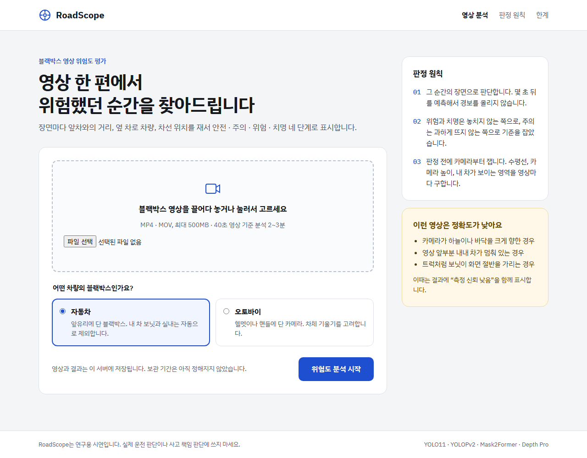
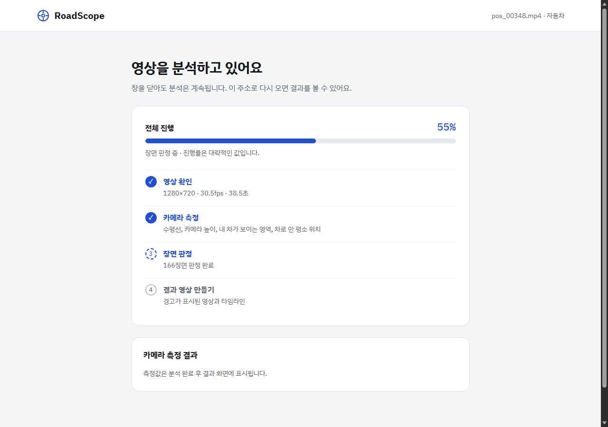
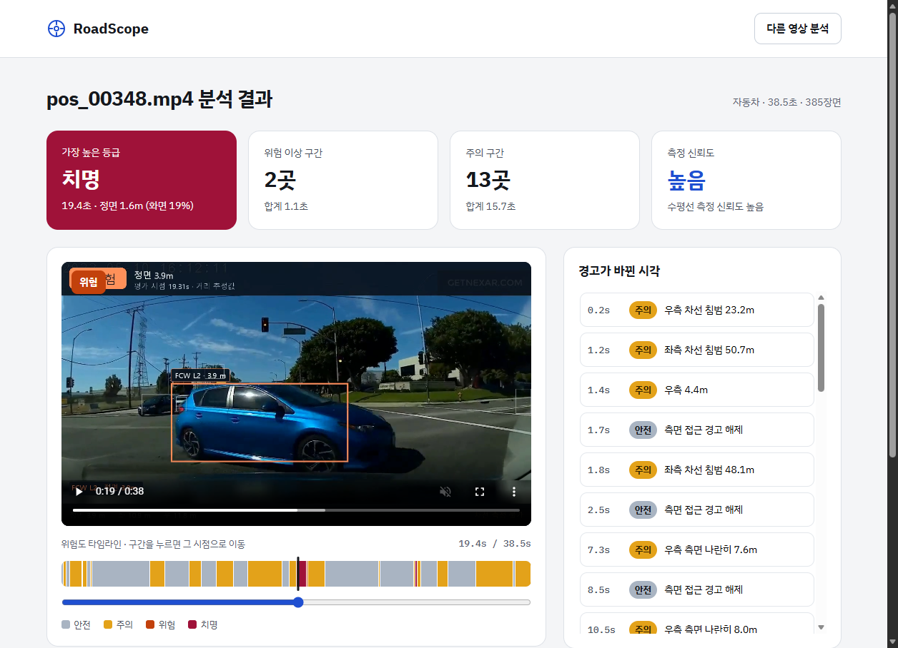
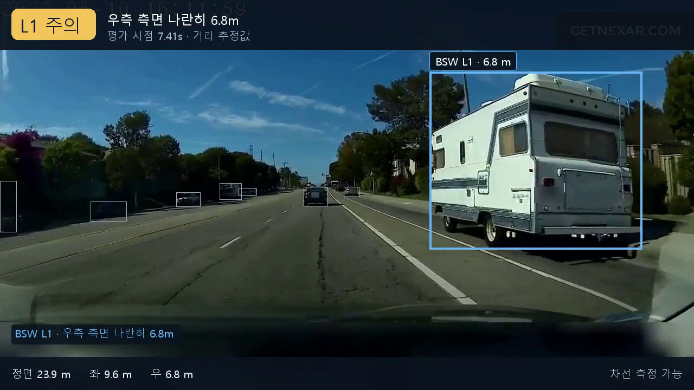
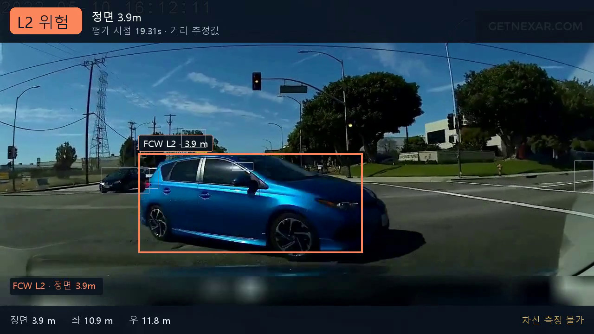
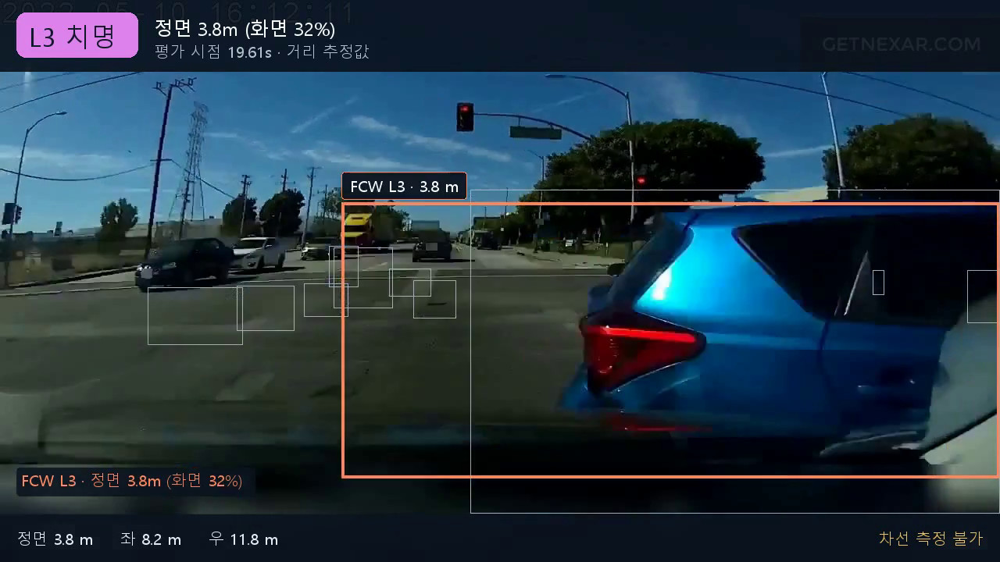
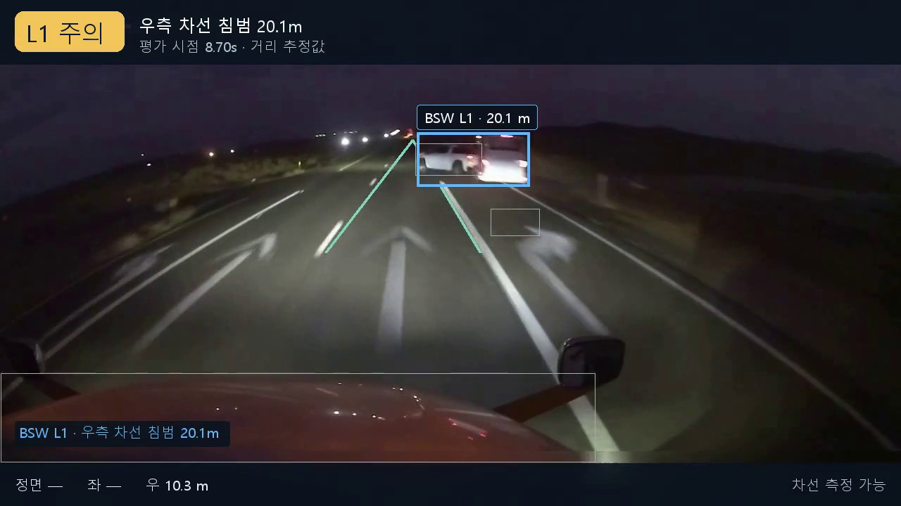
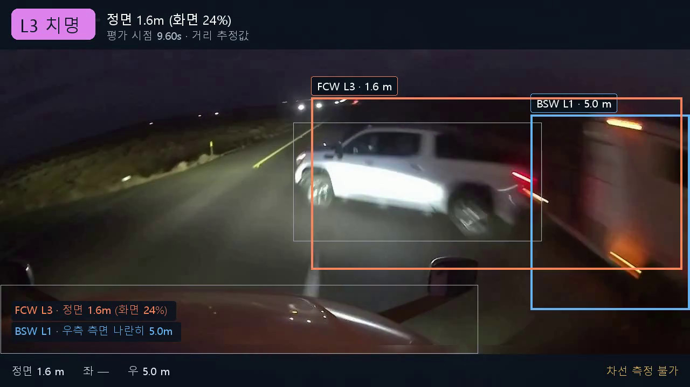
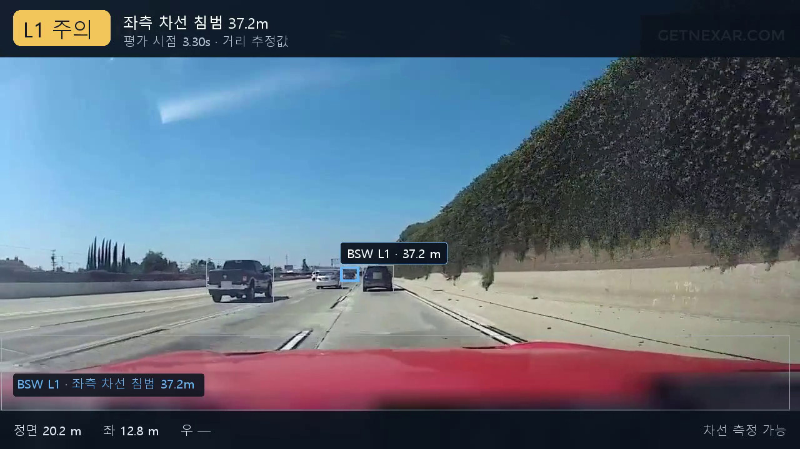

# RoadScope

RoadScope는 블랙박스 영상에서 장면별 위험도를 평가하고, 판정 근거를 영상과 타임라인으로 보여주는 프로젝트다. 사람과 차량, 차선, 내 차 영역을 구분하고 추정 거리와 위치에 따라 안전, 주의, 위험, 치명 네 등급을 기록한다. 자동차와 오토바이 모드가 있고, 웹에서 영상을 올리면 결과 영상과 경고 구간을 볼 수 있다. 주행 중 차량을 제어하거나 사고를 예측하는 시스템은 아니다.

## 화면

| 업로드 | 분석 중 |
|---|---|
|  |  |



결과 화면. 위험도 타임라인에서 구간을 누르면 그 시점으로 이동하고, 오른쪽에 경고가 바뀐 시각이 나온다. 알려진 문제: 결과 화면의 등급 배지가 HUD 영상 왼쪽 위 라벨과 겹친다.

| | |
|---|---|
|  |  |
| 낮. 오른쪽 캠핑카를 측면 나란히 주행으로 보고 주의(L1) | 낮. 교차로에서 끼어든 차, 위험(L2) 3.9 m |
|  |  |
| 같은 차, 치명(L3) 3.8 m | 밤 고속도로. 차선 검출과 오른쪽 차선 침범 주의(L1) |
|  |  |
| 밤. 끼어든 SUV, 치명(L3) 1.6 m | 낮 고속도로(정상 영상). 왼쪽 차선 침범 주의(L1) |

화면과 HUD 이미지는 [Nexar collision prediction](https://huggingface.co/datasets/nexar-ai/nexar_collision_prediction) 데이터셋의 개발 세트 영상을 아래 평가와 같은 엔진 버전으로 웹에서 분석한 결과다. 시험 세트 영상은 쓰지 않았다. 번호판과 얼굴이 보이는 부분은 흐리게 처리했다. 거리 값은 엔진의 추정값이다.

## 판정 원칙

- 그 순간의 장면을 기준으로 위험도를 평가한다. 충돌까지 남은 시간의 추정값(TTC)은 기록만 하고 등급 판정에는 쓰지 않는다.
- 위험과 치명 단계에서는 놓치는 경우를 줄이는 쪽을, 주의 단계에서는 불필요한 경고를 줄이는 쪽을 우선한다. 이는 설계 원칙이고 실제 성능은 아래 평가로 확인한다.
- 영상 단위 카메라 보정은 장면을 재기 위한 준비로 쓴다. 잠시 검출되지 않은 객체를 유지하는 추적 박스도 쓰므로, 모든 계산이 프레임마다 완전히 독립적이지는 않다.
- 차선이 보이지 않거나 측정 근거가 부족하면 측정 불가로 남긴다. 측정 불가를 주의 경고로 올리지 않으며, 위험이 없다는 뜻으로도 쓰지 않는다.
- 내 차 실내로 분류한 검출은 판정에서 빼고 기록에 `interior:true`를 남긴다.

## 처리 구조

```text
입력 영상
  → 카메라와 내 차 영역 보정
  → 객체, 차선, 주행 가능 영역 검출
  → 기하 기반 거리와 위치 계산
  → 장면별 위험도 판정
  → 결과 영상, 타임라인, 판정 기록
```

자동차 모드는 영상 구간별로 소실점, 수평선, 카메라 높이를 추정한다. 물체가 바닥에 닿는 위치와 차폭으로 거리를 계산하고, 쓸 수 없는 거리 성분은 뺀다. Depth Pro의 깊이값은 자동차 거리로 바로 쓰지 않고, 검출 박스가 없는 근접 물체를 잡는 보조 판단에만 쓴다.

차선 영점(보닛 위에서 차선이 실제로 보이는 가장 아래 행)의 근거가 부족하면 차선 편향 판단을 끈다. 영점의 차로 폭이 2.0~4.0 m 밖이면 차선을 믿지 않고, 보정과 거리 계산에서도 차선 정보를 뺀다.

오토바이 모드는 별도의 차선 분할 모델(lane_focus)과 기하 거리, Depth Pro 거리 성분을 쓴다. 결과는 `frames.jsonl`과 `meta.json`에 기록한다. 형식은 [docs/frame_schema.md](docs/frame_schema.md)에 있다. 웹의 경고 목록은 0.5초 미만의 짧은 끊김을 표시상 묶으며, 원래 프레임 등급은 바꾸지 않는다.

## 모델

| 모델 | 역할 | 쓰는 모드 |
|---|---|---|
| YOLO11m | 사람과 차량 검출 | 자동차, 오토바이 |
| YOLOPv2 | 차선과 주행 가능 영역 분할 | 자동차 |
| Mask2Former (Mapillary Vistas) | 보닛, 대시보드 같은 내 차 영역을 찾는 사전 점검 | 자동차 |
| Depth Pro | 깊이 추정, 근접 물체 보조 판단 | 자동차, 오토바이 (쓰는 방식이 다름) |
| lane_focus U-Net ResNet34 5-fold | 차선, 도로, 오토바이 영역 분할 | 오토바이 |

가중치는 리포에 없다. 출처, revision, 체크섬, 이용 조건, 놓을 위치는 [docs/models.md](docs/models.md)에 정리했다. 내 차 영역을 한 장에서 잡는 학생 모델(U-Net ResNet34, 교사 출력으로 증류 학습)도 실험했지만 기본 엔진에는 넣지 않았고 가중치도 공개하지 않는다. 학습 코드는 `tools/distill/`에 있다.

## 평가

Nexar collision prediction 데이터셋에서 개발 세트 30개와 시험 세트 99개를 따로 뽑았다. 개발 세트는 규칙을 고치는 데 쓴 영상이다. 시험 세트는 개발 세트, 증류 학습 영상과 파일 ID가 겹치지 않게 뽑았고(`tools/data/get_nexar_testset.py`), 최종 엔진으로 한 번만 실행했다. 시험 결과를 본 뒤 규칙을 고치지 않았다.

영상 단위 보정에서 수평선을 잡지 못한 구간(`failed`)이 하나라도 있는 영상은 이상치로 보고 본 지표에서 뺐다. 이상치는 따로 집계했다.

| 항목 | 개발 세트 | 시험 세트 |
|---|---|---|
| 전체 영상 | 30 | 99 |
| 보정 실패로 뺀 영상 | 3 | 15 |
| 본 지표 평가 영상 | 27 | 84 |
| 사고 영상 미탐 / 평가한 사고 영상 | 2 / 18 | 4 / 43 |
| 미탐률 [Wilson 95% CI] | 11.11% [3.10, 32.80] | 9.30% [3.68, 21.60] |
| 사고 전 3초 안 첫 위험 판정의 평균 선행 시간 [95% CI] (검출 영상 수) | 1.772 s [1.22, 2.31] (16) | 2.036 s [1.77, 2.30] (39) |
| 사고 구간 밖 위험 이상 프레임 비율 [95% CI] (프레임) | 20.67% [10.57, 33.83] (1327/6419) | 17.43% [13.26, 22.12] (3939/22596) |
| 정상 영상 주의 프레임 비율 [95% CI] (프레임) | 41.21% [24.27, 58.05] (1426/3460) | 47.05% [39.70, 54.26] (7371/15665) |
| 차선 편향 측정 가능 프레임 비율 [95% CI] (프레임) | 24.77% [13.16, 37.95] (2598/10487) | 31.33% [24.41, 38.55] (10135/32351) |
| 전 구간 차선 신뢰 영상 / 평가 영상 [Wilson 95% CI] | 12/27, 44.44% [27.59, 62.69] | 47/84, 55.95% [45.31, 66.08] |

조명별 결과 (본 지표 기준)

| 세트 | 조명 | 평가/전체 영상 | 보정 실패 | 미탐/사고, 미탐률 [Wilson 95% CI] | 사고 구간 밖 위험 이상 [95% CI] | 정상 영상 주의 [95% CI] |
|---|---|---|---|---|---|---|
| 개발 | 낮 | 20/23 | 3 | 1/14, 7.14% [1.27, 31.47] | 16.97% [8.11, 29.80] | 47.57% [26.16, 66.27] |
| 개발 | 밤 | 5/5 | 0 | 0/3, 0.00% [0.00, 56.15] | 44.09% [9.13, 74.25] | 13.70% [8.35, 19.11] |
| 개발 | 기타(Twilight 등) | 2/2 | 0 | 1/1, 100.00% [20.65, 100.00] | 2.43% [1.74, 2.73] | 61.04% [61.04, 61.04] |
| 시험 | 낮 | 76/90 | 14 | 4/39, 10.26% [4.06, 23.58] | 18.34% [13.79, 23.30] | 47.49% [39.64, 54.99] |
| 시험 | 밤 | 2/3 | 1 | 0/1, 0.00% [0.00, 79.35] | 0.00% [0.00, 0.00] | 13.22% [13.22, 13.22] |
| 시험 | 기타(Twilight 등) | 6/6 | 0 | 0/3, 0.00% [0.00, 56.15] | 12.50% [2.77, 32.93] | 53.29% [23.49, 72.95] |

지표 정의

- 미탐: 사고 시각 전 3초 창 안에 위험(L2) 이상 판정이 하나도 없는 사고 영상.
- 선행 시간: 같은 3초 창에서 첫 위험 이상 판정부터 사고 시각까지의 시간. 검출한 사고 영상만 평균했고, 창이 3초라 최대 3초다. 사고 시각 기준으로 결과를 맞춰 본 지표이며 미래 예측 성능을 뜻하지 않는다.
- 사고 구간 밖 위험 이상: 정상 영상 전체와 사고 영상의 사고 3초 전 이전 프레임에서 위험 이상 판정의 비율. 실제 오경보를 정답으로 확인한 값이 아닌 대리 지표다.
- 정상 영상 주의: 정상 영상 프레임 가운데 주의(L1) 판정의 비율.
- 신뢰구간: 미탐률과 차선 신뢰 영상 비율은 Wilson 95% 구간이다. 프레임 비율과 선행 시간은 영상 단위 부트스트랩 95% 구간이다(10,000회, seed 20261010, 백분위). 영상을 독립 표본으로 보며 같은 주행의 상관은 반영하지 않았고, 다중 비교 보정은 하지 않았다. 영상이 1~2개뿐인 칸은 부트스트랩 구간이 한 점으로 줄어드는데, 불확실성이 없다는 뜻이 아니다.
- 개발 세트 수치는 규칙을 고칠 때 본 영상의 결과라서 시험 세트보다 유리하게 나올 수 있다.

평가한 엔진 파일의 SHA-256 앞 12자리는 `engine.py` 67d108a238dc, `geom_car.py` ae9bd055612f, `car_models.py` 95a075032333, `mvp.py` 00bf0d711064이다. 출발점 리포의 파일 기준이며, 이 리포의 사본은 import, 경로 설정, 주석만 바뀌었다(`mvp.py`는 `rules.py`로 이름을 바꿨다). 평가 스크립트는 `tools/evaluate/eval_nexar.py`다.

## 한계

- 정상 영상에서도 주의가 자주 뜬다. 시험 세트 정상 영상 프레임의 47.1%가 주의였다. 개발 과정에서는 차선 침범과 측면 나란히 판정을 주된 원인으로 보고 수정을 보류했다. 시험 세트의 원인별 분해는 하지 않았다.
- 시험 영상 99개 중 15개는 보정에 실패해 본 지표에서 빠졌다. 이 15개 안의 사고 영상 6개 중 2개는 미탐이었다. 카메라가 크게 기울었거나 도로와 앞차가 충분히 보이지 않으면 보정에 실패할 수 있다.
- 밤 영상이 적다. 시험 세트에 3개(본 지표 2개), 개발 세트에 5개뿐이라 밤 성능은 이 결과로 판단할 수 없다.
- 시험 세트 미탐 4건은 사고 전 3초 동안 정면 객체의 기록 거리가 모두 5 m 이상이어서 거리 기준 위험(L2)에 이르지 못했다. 거리 추정이 맞았는지, 그 객체가 실제 사고 당사자였는지는 기록만으로 확인하지 않았다.
- 거리는 도로와 차량 크기 가정을 쓰는 기하 추정값이며, 실제 정답 거리로 검증하지 않았다. 경사, 가림, 잘린 검출 박스, 잘못 잡은 차선이 거리와 등급에 영향을 줄 수 있다.
- 독립적인 카메라 높이 근거가 없으면 차선으로 구한 높이를 차로 폭 검산에 다시 쓸 수 있다. 이 경우 검산이 완전히 독립적이지 않다.
- 시험 세트가 작아서 신뢰구간이 넓다. 예를 들어 시험 미탐률의 95% 구간은 3.68%~21.60%다.
- 영상마다 사전 보정과 여러 모델 추론이 필요하다. 실시간 처리나 일정한 처리 속도를 보장하지 않는다.
- 웹은 로컬 시연용이다. 업로드와 결과를 자동으로 지우는 기능이 없다.

## 실행 방법

### 설치

Python 3.12 기준이다. 아래 순서는 개발 환경의 패키지 버전을 옮겨 적은 것이며, 새 환경에서 이 순서대로 설치해 검증하지는 않았다.

```powershell
git clone https://github.com/minoak/roadscope
cd roadscope
python -m venv .venv
.venv\Scripts\Activate.ps1
pip install -r requirements.txt
pip install -e . --no-deps
```

`requirements.txt`의 torch는 CUDA 12.4 빌드다. CPU만 쓰려면 파일 안의 안내대로 바꾼다. `pip install -e .`을 하지 않으려면 `$env:PYTHONPATH = 'src'`를 설정하고 리포 루트에서 실행한다.

모델 가중치를 [docs/models.md](docs/models.md)대로 받는다. 기본 위치는 리포의 `models/`이고, 다른 곳에 두면 `ROADSCOPE_MODELS_DIR`, `ROADSCOPE_LANE_DIR`로 지정한다. HUD의 한글 글꼴을 찾지 못하면 `HUD_FONT`에 TTF 또는 TTC 파일 경로를 지정한다.

### 웹

```powershell
$env:HF_HUB_OFFLINE = '1'
$env:TRANSFORMERS_OFFLINE = '1'
python -m uvicorn web.server:app --host 127.0.0.1 --port 7861 --workers 1
```

브라우저에서 `http://127.0.0.1:7861`을 열고 영상을 올린 뒤 자동차 또는 오토바이를 고른다. 기본 장치는 CUDA이고, 없으면 CPU로 실행해 시간이 오래 걸린다.

저장된 결과만 볼 때는 엔진을 막고 조회 경로를 연다.

```powershell
$env:CUDA_VISIBLE_DEVICES = '-1'
$env:ROADSCOPE_DEV = '1'
$env:ROADSCOPE_DISABLE_ENGINE = '1'
python -m uvicorn web.server:app --host 127.0.0.1 --port 7861 --workers 1
```

결과 폴더는 `http://127.0.0.1:7861/dev/load?run=<runs_out 아래 상대 경로>`로 연다. 리포에는 결과가 들어 있지 않으므로 먼저 엔진으로 만들어야 한다. 웹 API와 요약 규칙은 [web/README.md](web/README.md)에 있다.

### 명령줄

```powershell
$env:HF_HUB_OFFLINE = '1'
$env:TRANSFORMERS_OFFLINE = '1'
python -m roadscope.engine data/my_clip.mp4 --vehicle car --out runs_out
python -m roadscope.viz data/my_clip.mp4 runs_out/my_clip --out runs_out/my_clip/hud.mp4
```

GPU가 없으면 엔진에 `--device cpu`를 붙인다. 입력 영상, 모델, 결과는 Git에 넣지 않는다(`.gitignore`).

### 테스트

```powershell
$env:CUDA_VISIBLE_DEVICES = '-1'
python -m unittest discover -s tests -t .
```

단위 테스트 65개는 합성 데이터로 CPU에서 돌며 모델 가중치나 영상이 필요 없다. 엔진의 실제 영상 처리는 테스트하지 않는다.

### 평가 다시 하기

`tools/data/`의 스크립트로 Nexar 영상과 라벨을 받고(Hugging Face에서 데이터셋 조건 동의 필요), 엔진으로 결과를 만든 뒤 `tools/evaluate/eval_nexar.py --labels <labels.csv> --runs <결과 폴더>`로 평가한다. 위 표를 만든 `--t46` 모드는 실행 기록 파일(`run_log.md`)의 엔진 해시 대조까지 하는데, 그 기록을 만든 일괄 실행 스크립트는 이 리포에 넣지 않았다.

## 폴더

```text
src/roadscope/   엔진 (engine, geom_car, car_models, rules, tracker, viz, config)
web/             FastAPI 서버와 화면
tools/evaluate/  평가 (eval_nexar, eval_distance, rejudge_ldw_vb)
tools/data/      Nexar 영상 목록 만들기와 받기
tools/distill/   내 차 영역 학생 모델 라벨 생성, 학습, 평가
tools/render/    차선 디버그 그림, 이미지를 영상으로 잇기
tests/           단위 테스트
docs/            모델 안내, 프레임 형식, 이미지, 개발 기록
```

## 출발점

이 프로젝트는 AIFFEL_quest_eng 리포의 Quest02에서 출발했다. 이 리포는 새 이력으로 시작했고, 시작 시점의 코드는 아래 커밋에 있다.

- https://github.com/minoak/AIFFEL_quest_eng/tree/b6aad7411ffdfc9d4518c56f9d253523b8751ba8/Main_Quest/Quest02

## 개발 방식

작성자(GitHub 계정 minoak)가 목표와 판정 원칙을 결정하고, Cowork가 작업 지시와 진행 상태를 관리했다. Claude Code와 Codex는 역할을 나누어 구현과 검증을 수행했다. 작업 지시, 결정과 검증 기록 가운데 공개 가능한 내용을 정리해 [docs/dev-log/](docs/dev-log/)에 함께 제공한다. 개인 경로와 운영 정보가 들어 있는 원본 로그는 제외했으며, 공개 기록은 실행 결과와 아직 검증하지 못한 부분을 구분한다.

## 라이선스

소스 코드는 [AGPL-3.0-only](LICENSE)다. 검출에 쓰는 Ultralytics가 AGPL-3.0이기 때문이다. `src/`와 `web/`의 Python 파일 첫 줄에 `SPDX-License-Identifier: AGPL-3.0-only`를 적었다. 모델 가중치와 데이터는 이 라이선스에 포함되지 않으며 각 공급자의 조건을 따른다. 일부 가중치와 데이터의 조건은 확인하지 못했다. 자세한 내용은 [THIRD_PARTY_NOTICES.md](THIRD_PARTY_NOTICES.md)에 있다.
